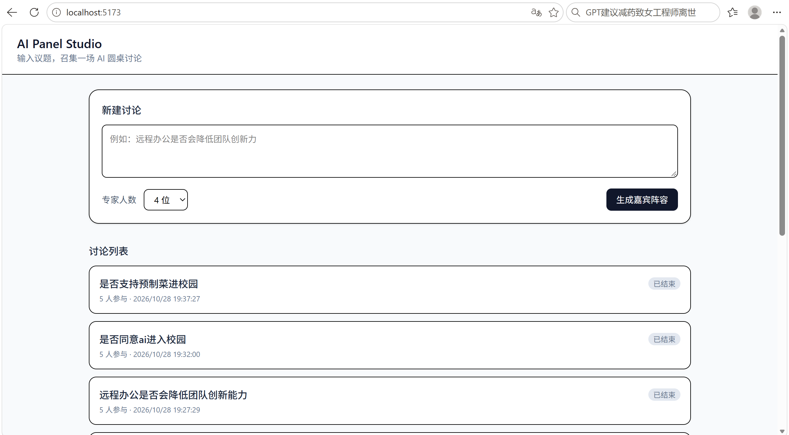
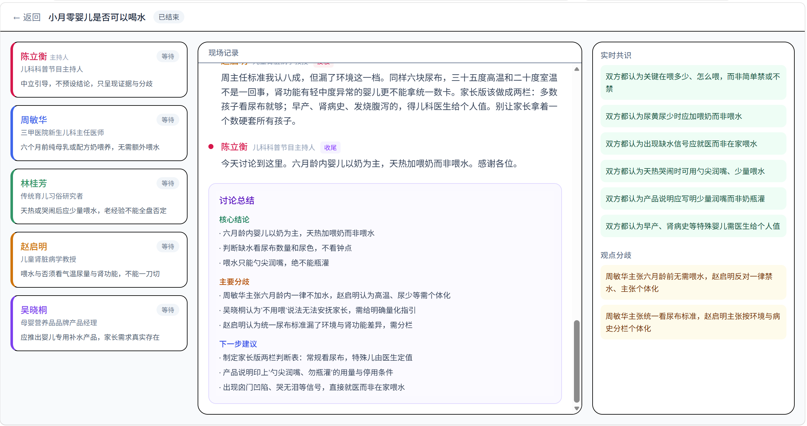

# AI Panel Studio — AI 圆桌讨论 Web App

> 输入一个议题，即时生成一套立场互不相同的专家阵容，然后观看一场由 AI 自主推进的圆桌讨论：主持人控场、专家抢话反驳、共识与分歧实时浮现。

## 目录

- [功能特性](#功能特性)
- [技术栈](#技术栈)
- [项目结构](#项目结构)
- [快速开始](#快速开始)
- [环境变量](#环境变量)
- [API 列表](#api-列表)
- [数据库](#数据库)
- [测试](#测试)
- [验收步骤](#验收步骤)
- [已完成与待改进](#已完成与待改进)

## 文档索引

| 文档 | 路径 | 内容 |
|---|---|---|
| PRD | [docs/PRD.md](docs/PRD.md) | 产品定位、用户画像、功能需求与技术约束 |
| ER 图 | [docs/er.md](docs/er.md) | 数据模型（mermaid erDiagram），事件溯源设计 |
| API 契约 | [docs/api.md](docs/api.md) | REST + SSE 接口定义与事件类型 |
| Prompt 记录 | [docs/prompt-log.md](docs/prompt-log.md) | 5 段核心 Prompt，覆盖 SDD / PDD / TDD / E2E |
| 工作流说明 | [docs/workflow.md](docs/workflow.md) | 开发过程、问题与解决路径、工程化思考 |


## 功能特性

| 模块 | 说明 |
|---|---|
| 首页 | 讨论列表 + 新建讨论（议题 + 专家人数 3~6） |
| 嘉宾生成 | 调用 LLM 动态生成 1 位主持人 + N 位专家，含姓名、头衔、立场、专属颜色 |
| 直播调度 | 主持人逐轮提问，专家基于当前 transcript **自主决定**是否发言，每轮 1~2 人，禁止机械轮流 |
| 专家状态小窗 | 独立卡片展示 `waiting / preparing / speaking` 与公开关注点（不含思维链） |
| 实时共识与分歧 | 每轮结束后增量提取，讨论进行中即出现在侧栏 |
| 现场记录 | 按发言者专属颜色渲染 transcript，支持回放 |
| 结构化总结 | 主持人自然收尾 + 页面渲染 JSON 总结（结论 / 分歧 / 建议） |
| 实时推送 | SSE 事件流，支持断线重连补发 |
| 多讨论隔离 | 所有数据按 `discussion_id` 隔离，可同时进行 |

## 界面预览

| 首页 | 直播间 |
|---|---|
|  |  |


## 技术栈

| 层 | 选型 | 选择理由 / 权衡 |
|---|---|---|
| 前端 | React 19 + Vite + TypeScript + Tailwind CSS v4 | Vite 冷启动快、开发反馈即时；Tailwind 适合三栏这种自定义布局，无需引入重型 UI 库 |
| 后端 | Node.js + Express 5 + TypeScript | 与前端同语言，SSE 在 Node 上实现简单；Express 5 原生支持 async 错误传递 |
| 数据库 | SQLite（better-sqlite3） | 单机演示场景零配置、文件级持久化；better-sqlite3 同步 API 避免回调节奏问题 |
| 校验 | Zod | 模型输出不稳定，用 schema 在入口做强校验，非法即降级 |
| 模型 | DeepSeek（deepseek-chat） | OpenAI 兼容接口，支持 `response_format: json_object`，便于结构化输出 |
| 测试 | Vitest + Playwright | 纯逻辑与交互契约分层覆盖，单元测试快、E2E 验证真实渲染 |


## 项目结构

```
ai-panel-studio/
├─ docs/
│  ├─ PRD.md              # 产品需求文档
│  ├─ er.md               # 数据模型（mermaid ER 图）
│  ├─ api.md              # API 契约
│  ├─ prompt-log.md       # 核心 Prompt 记录（5 段）
│  └─ workflow.md         # 开发过程与工程化思考
├─ server/
│  ├─ src/
│  │  ├─ db/              # schema.sql / index.ts / seed.ts
│  │  ├─ core/            # panelist / scheduler / consensus（纯逻辑）
│  │  ├─ repo/events.ts   # 事件写入、广播、补发
│  │  ├─ services/runner.ts # 讨论主循环
│  │  ├─ routes/          # REST + SSE
│  │  ├─ llm.ts           # 模型调用封装
│  │  └─ index.ts         # Express 入口
│  └─ .env.example
└─ web/
   ├─ src/
   │  ├─ pages/           # HomePage / RoomPage
   │  ├─ components/      # ParticipantCard / TranscriptItem / ConsensusPanel
   │  ├─ hooks/           # useDiscussionStream
   │  ├─ api.ts / types.ts
   │  └─ App.tsx
   ├─ tests/              # Playwright E2E
   └─ playwright.config.ts
```

## 快速开始

### 1. 环境要求

- Node.js ≥ 20（推荐 22 LTS 或 24 LTS）
- npm ≥ 10

### 2. 安装依赖

```bash
cd server && npm install
cd ../web && npm install
```

### 3. 配置环境变量

```bash
cd server
copy .env.example .env      # Windows
# cp .env.example .env      # macOS / Linux
```

编辑 `server/.env`，填入 DeepSeek API Key：

```
DEEPSEEK_API_KEY=sk-你的密钥
DEEPSEEK_BASE_URL=https://api.deepseek.com
PORT=3001
```

### 4. 初始化数据库

```bash
cd server
npm run seed
```

预期输出 `已写入 5 条样例讨论`，并打印 discussions / participants / messages 统计表。

### 5. 启动（需要两个终端）

```bash
# 终端 A
cd server && npm run dev      # http://localhost:3001

# 终端 B
cd web && npm run dev         # http://localhost:5173
```

浏览器访问 http://localhost:5173

### 6. E2E 测试浏览器

Playwright 需要浏览器运行时，二选一：

- **方式一（推荐，无需下载）**：`playwright.config.ts` 已配置 `channel: 'msedge'`，直接使用系统自带 Edge。
- **方式二**：下载 Playwright 自带 Chromium
  ```bash
  npx playwright install chromium
  # 国内网络受限时使用镜像：
  # PowerShell: $env:PLAYWRIGHT_DOWNLOAD_HOST="https://cdn.npmmirror.com/binaries/playwright"
  ```

## 环境变量

| 变量 | 必填 | 默认值 | 说明 |
|---|---|---|---|
| `DEEPSEEK_API_KEY` | ✅ | — | **仅服务端读取**，绝不下发前端 |
| `DEEPSEEK_BASE_URL` | ❌ | `https://api.deepseek.com` | 接口地址 |
| `PORT` | ❌ | `3001` | 后端端口 |
| `DB_FILE` | ❌ | `server/data/panel.db` | 数据库文件路径 |

> ⚠️ `.env` 已在 `.gitignore` 中，**不会进入仓库**。提交前请确认 `git status` 中无 `.env`。

## API 列表

| 方法 | 路径 | 说明 |
|---|---|---|
| GET | `/api/health` | 健康检查 |
| GET | `/api/discussions` | 讨论列表 |
| POST | `/api/discussions` | 创建讨论并生成阵容 |
| GET | `/api/discussions/:id` | 讨论详情（嘉宾/消息/共识/总结） |
| POST | `/api/discussions/:id/start` | 开始直播（202，后续走 SSE） |
| GET | `/api/discussions/:id/stream` | **SSE 事件流**（支持 `Last-Event-ID`） |
| POST | `/api/discussions/:id/end` | 结束并返回总结 |
| DELETE | `/api/discussions/:id` | 删除讨论 |

SSE 事件类型：`round_start`、`speech`、`agent_status`、`consensus_update`、`summary`、`error`、`done`。
详细契约见 [docs/api.md](docs/api.md)。

## 数据库

- 权威事实来源：`events` 表（`seq` 全局自增，不可修改）
- 其余表（`messages` / `consensus_items` / `agent_states`）均为事件流的**投影**
- ER 图见 [docs/er.md](docs/er.md)
- 建表脚本：`server/src/db/schema.sql`（应用启动时自动执行，`IF NOT EXISTS` 幂等）

重置数据：

```bash
rm server/data/panel.db    # Windows: Remove-Item .\server\data\panel.db
cd server && npm run seed
```

## 样例数据

`npm run seed` 会写入以下 5 条讨论（其中 1 条已结束，可直接查看完整总结与共识/分歧）：

| # | 议题 | 嘉宾阵容 | 状态 |
|---|---|---|---|
| 1 | （按 seed.ts 真实内容填） | 主持人 + N 位专家 | 已结束 |
| 2 | … | … | 未开始 |
| 3 | … | … | 未开始 |
| 4 | … | … | 未开始 |
| 5 | … | … | 未开始 |


## 测试

```bash
# 单元测试（后端纯逻辑）
cd server && npm test

# E2E 测试（前端交互与渲染契约）
cd web && npx playwright test
```

| 层级 | 工具 | 覆盖内容 |
|---|---|---|
| 单元 | Vitest | 发言调度 7 条硬性规则（人数、非法 id、连续发言、必须反驳、长度、重复） |
| E2E | Playwright | 首页列表渲染、直播页三栏结构、transcript、共识/分歧、总结区块 |

> **E2E 采用网络层 mock**，不打真实模型：真实 LLM 存在 5~30 秒延迟与输出不确定性，作为自动化测试不可重复。真实链路通过下方「验收步骤」人工验证。

## 验收步骤

1. 首页看到 5 条 seed 讨论
2. 新建议题「大学是否应全面采用 AI 辅助教学」，专家 4 人 → 跳转直播间，左栏出现 5 位嘉宾且颜色互不相同
3. 点击「开始讨论」→ 3 秒内出现主持人开场
4. 观察 3 轮以上：每轮发言人数为 1~2；无专家连续两轮发言；出现至少 1 次「反驳」标签
5. 第 2~3 轮时右栏已出现共识/分歧卡片（非结束时才生成）
6. 结束后页面底部出现「讨论总结」，含结论/分歧/建议三块
7. 打开两个讨论，确认 A 的发言不会出现在 B 的页面
8. F12 → Network，搜索 `sk-`，应无任何结果

## 已完成与待改进

### 已完成

- 完整前后端分离架构，API Key 仅存服务端
- 事件驱动的讨论调度，逐轮推进 + 硬性规则校验 + 兜底降级
- SSE 实时推送，支持 `seq` 断线重连补发
- 实时共识/分歧增量提取
- 三栏响应式布局，各区域独立滚动
- 5 条高质量样例数据（含已结束的完整讨论）
- 7 条单元测试 + 2 条 E2E 测试

### 待改进

- 讨论并发上限未做限流，多用户同时创建可能触发模型频率限制
- `running` 状态未做服务重启后的自动恢复（应重置为 `interrupted`）
- 共识条目未做语义去重，长讨论可能出现表述近似的重复项
- 未做移动端专门适配（仅响应式降级）
- 未接入鉴权与多用户隔离
