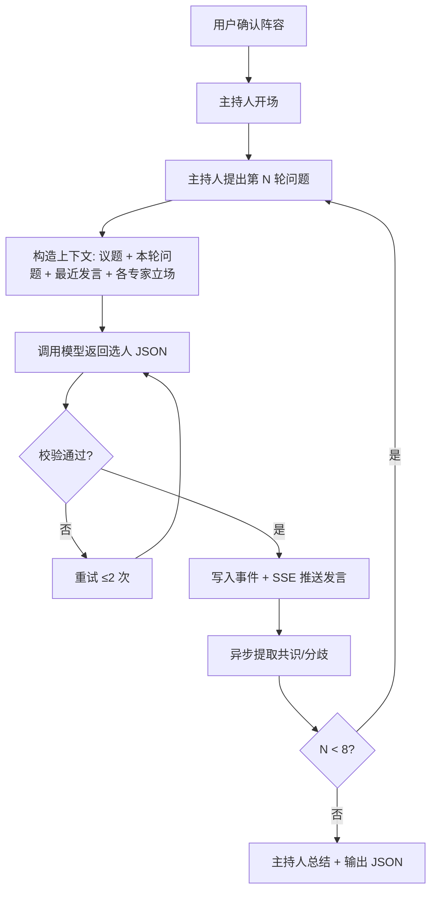

# AI Panel Studio — 产品需求文档（PRD）

| 项目 | 内容 |
|---|---|
| 版本 | v0.1 |
| 日期 | 2026-10-28 |
| 状态 | MVP 开发中 |

## 1. 产品定位

**AI Panel Studio** 是一个本地运行的 AI 圆桌讨论 Web App。用户输入一个议题并指定专家人数（默认 4 人），系统调用大模型即时生成一位主持人 + 若干位立场互不相同的专家，随后进入"直播"模式，实时观看一场由 AI 自主推进的圆桌讨论。

**核心价值**：把"一个人问 AI"变成"看一群人辩论"。用户获得的不是一个结论，而是一场带立场冲突、带共识演化的讨论过程。

## 2. 目标用户

| 用户群体 | 典型场景 | 核心诉求 |
|---|---|---|
| 知识工作者 / 研究人员 | 需要快速对一个议题做多角度审视，时间有限 | 在几分钟内获得来自不同视角的深度分析与争辩 |
| 产品 / 决策人员 | 方案评审或战略讨论前，希望预演各方立场与潜在争议 | 发现盲点、检验假设、提升决策质量 |
| 教育与内容创作者 | 需要把复杂议题结构化地呈现给受众 | 获得一场可回放、可复用的"虚拟专家访谈"素材 |

## 3. 用户痛点

| # | 痛点 | 现状 |
|---|---|---|
| 1 | **视角单一** | 单一 AI 的回答往往立场中立、面面俱到，缺乏真实辩论带来的批判性深度 |
| 2 | **步骤割裂** | 用户在不同对话窗口间来回提问，上下文碎片化，观点之间没有真正"碰撞" |
| 3 | **过程不可见** | 只拿到最终结论，看不到观点如何演化，沉浸感弱 |
| 4 | **议题管理混乱** | 多个议题混在一个会话里，讨论线索互相干扰 |

## 4. 核心概念

| 术语 | 定义 |
|---|---|
| **Discussion（讨论）** | 一次完整的圆桌会话，包含议题、嘉宾阵容、全部事件与产物 |
| **Panelist（嘉宾）** | 参会者，分为 `host`（主持人，1 人）与 `expert`（专家，N 人） |
| **Round（轮次）** | 主持人提出一个问题 → 1~2 位专家回应，为一个轮次 |
| **Event（事件）** | 系统中发生的一切可观测变化的原子记录，是**唯一权威事实来源** |
| **Consensus / Disagreement** | 讨论过程中被实时提取出的"已达成共识"与"存在分歧"的条目 |

## 5. 功能需求

### 5.1 首页

- 展示全部讨论卡片：议题、专家人数、状态（进行中 / 已结束）、创建时间
- 卡片可点击进入回放视图
- 提供「新建讨论」表单：议题输入框（必填，10~200 字）+ 专家人数选择（3~6 人）
- 刷新页面后数据仍在（持久化在 SQLite）

### 5.2 嘉宾生成

- 用户提交议题后，后端调用大模型生成 1 位主持人 + N 位专家
- 每位嘉宾包含：`name`、`title`（头衔）、`stance`（一句话立场）、`color`（专属颜色）
- 颜色必须互不重复，且与深色/浅色背景都有足够对比度
- 用户可以查看阵容后点击「进入直播」

**验收**：同一议题重复生成，专家的 `stance` 不得完全一致（体现多视角）。

### 5.3 直播调度（核心）

| 规则 | 要求 |
|---|---|
| 每轮发言人数 | 1 ~ 2 人 |
| 发言者产生方式 | 由模型基于**当前 transcript 与各专家立场自主选择**，不得机械轮流 |
| 连续发言限制 | 同一专家不得连续两轮发言 |
| 反驳要求 | 每 3 轮内至少出现 1 次 `rebut`（明确反驳他人观点） |
| 主持人职责 | 开场 → 逐轮提问 → 收束 → 结束语 |
| 异常降级 | 模型返回非合法 JSON 时重试 2 次，仍失败则由主持人生成兜底发言，流程不中断 |
| 轮次上限 | 8 轮后主持人自动收尾 |

### 5.4 专家状态小窗

- 每位专家一个独立卡片，实时展示 Agent 状态：`waiting`（等待）/ `preparing`（准备发言）/ `speaking`（发言中）
- 显示当前关注点或公开备忘（一句话摘要）
- **不展示真实思维链（chain-of-thought）**

### 5.5 实时共识与分歧

- 每轮结束后增量提取，而非结束时一次性生成
- 每条记录包含：类型（consensus / disagreement）、内容、首次出现的轮次
- 前端以侧栏卡片实时追加

### 5.6 Transcript（现场记录）

- 逐条追加，包含发言者姓名 + 头衔 + 专属颜色块
- 主持人、专家视觉上可区分
- **不出现"举手""抢麦""排队"等内部调度机制字样**

### 5.7 总结

- 讨论结束后主持人输出自然语言结束语
- 页面下方渲染结构化 JSON 总结：核心结论、主要分歧、下一步建议

## 6. 数据与事实来源

**`events` 表是系统的唯一权威事实来源（Single Source of Truth）。**

`messages`、`consensus_items`、`agent_states` 均为事件流在特定维度上的**投影（projection）**，可由事件重建。

- SSE 按 `events.seq` 单调递增推送，前端断线重连时携带 `Last-Event-ID`，服务端从此序号后补发
- 所有查询必须携带 `discussion_id` 条件，保证多个讨论之间状态、事件流、transcript、共识与分歧完全隔离

## 7. 非功能需求

| 类别 | 要求 |
|---|---|
| 密钥安全 | 大模型 API Key 仅存于服务端环境变量，**不得出现在任何前端代码或网络响应中** |
| 实时性 | 使用 SSE 推送事件，禁止使用轮询 |
| 多讨论 | 支持多个讨论并存，数据互相隔离 |
| 数据持久化 | SQLite，服务重启后数据不丢失 |
| 布局 | 桌面端三栏布局，各区域在自身容器内独立滚动；适配普通桌面 / 宽屏 / 窄屏 |

## 8. 验收标准（E2E）

| # | 场景 | 通过条件 |
|---|---|---|
| 1 | 创建讨论 | 返回 1 位主持人 + N 位专家，颜色唯一，立场各不相同 |
| 2 | 开始直播 | 3 秒内有事件通过 SSE 到达前端 |
| 3 | 发言调度 | 连续 5 轮中每轮发言者数为 1 或 2；无专家连续两轮发言 |
| 4 | 反驳 | 前 6 轮内至少出现 1 条 `act = rebut` |
| 5 | 共识提取 | 讨论进行到第 3 轮时，共识/分歧区已出现条目（未结束即存在） |
| 6 | 隔离性 | 同时开启两个讨论，A 的发言不会出现在 B 的 transcript 中 |
| 7 | 总结 | 结束后页面渲染出合法 JSON 总结区块 |
| 8 | 安全 | 浏览器 Network 面板中搜不到 `sk-` 开头的字符串 |

## 9. 本期不做（Out of Scope）

- 用户登录与权限体系
- 讨论的分享链接与协作
- 语音/TTS 播报
- 专家打断的实时人工干预
- 移动端专门适配（仅做响应式降级）

## 10. 里程碑

| 阶段 | 内容 |
|---|---|
| M1 | 文档与数据模型定稿（PRD / ER / API） |
| M2 | 后端骨架：SQLite schema、嘉宾生成、调度器、SSE |
| M3 | 前端三栏页面与直播流对接 |
| M4 | 单元测试 + E2E 测试 |
| M5 | 文档收尾与提交 |
