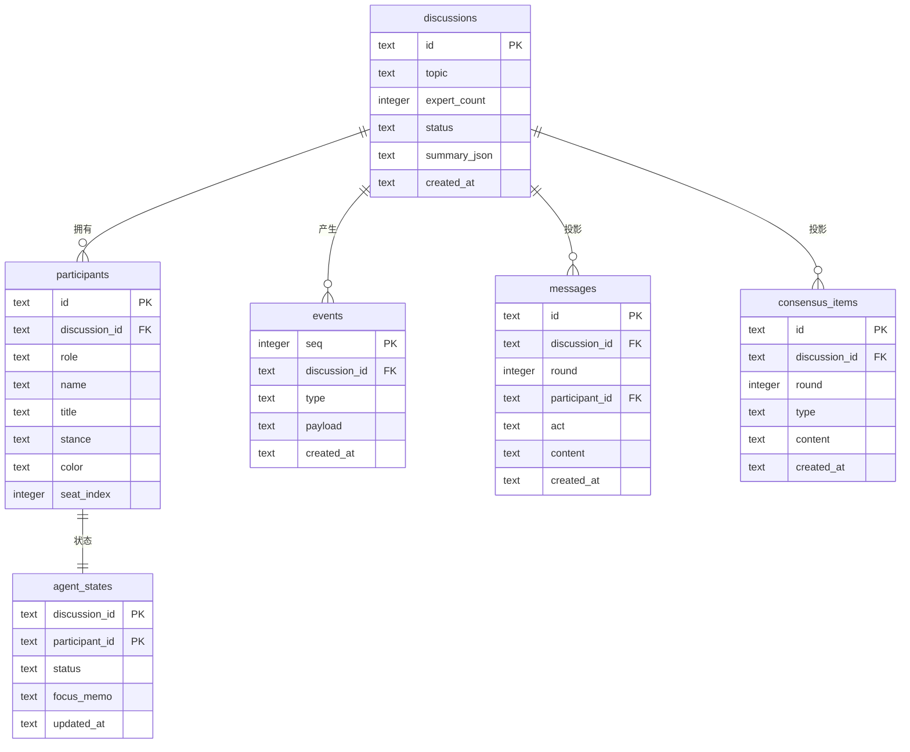

# 数据模型设计（ER）

## 设计原则

1. **`events` 是唯一权威事实来源（Single Source of Truth）**
   系统内一切状态变化都以事件追加写入，`seq` 全局单调递增，不可修改、不可删除。
2. **其余表均为投影（projection）**
   `messages`、`consensus_items`、`agent_states` 都可由 `events` 重放重建。
   好处：断线重连只需按 `seq` 补发；出 bug 时可回放复现。
3. **多讨论隔离**
   所有表均携带 `discussion_id`，全部查询必须带该条件。

## ER 图

## 表说明

| 表 | 作用 | 为什么需要 |
|---|---|---|
| `discussions` | 讨论主体 | 议题、人数、状态、总结的唯一归属 |
| `participants` | 嘉宾阵容 | 承载姓名/头衔/立场/专属色，直播页渲染依据 |
| `events` | **权威事件流** | SSE 推送源；断线重连补发依据；可回放 |
| `messages` | 发言投影 | 按轮次查询 transcript，避免每次解析 payload |
| `consensus_items` | 共识/分歧投影 | 讨论中实时追加，支撑右侧卡片 |
| `agent_states` | 专家状态投影 | 驱动小窗的 waiting/preparing/speaking |
